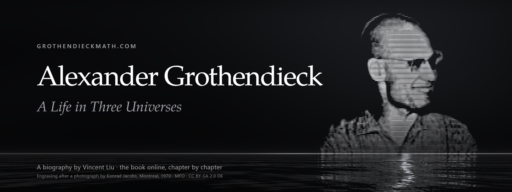

  

    

  <b><a href="https://grothendieckmath.com/">grothendieckmath.com</a></b> ·
  <a href="https://grothendieckmath.com/biography/">The Biography</a> ·
  <a href="https://grothendieckmath.com/life/">Life</a> ·
  <a href="https://grothendieckmath.com/mathematics/">Mathematics</a> ·
  <a href="https://grothendieckmath.com/philosophy/">Philosophy</a> ·
  <a href="https://grothendieckmath.com/writings/">Writings</a> ·
  <a href="https://grothendieckmath.com/sources/">Sources</a> ·
  <a href="https://grothendieckmath.com/zh/">中文</a> ·
  <a href="https://wisemotif.ai">WiseMotif.ai</a>

**grothendieckmath.com** is the companion site of *Alexander Grothendieck: A Life in Three Universes*, a biography by Vincent Liu
(*Lives of Mathematical Thought* · 1, WiseMotif.ai): the book online, chapter by chapter, with its notes beside the text,
its bibliography, its illustration credits and its index of names; and around it, the life, the mathematics and the
philosophy of Alexander Grothendieck (1928–2014) as the book tells them. In English, with a Chinese edition of the site
at [/zh/](https://grothendieckmath.com/zh/).

This repository holds the built site only — static HTML, CSS, scripts, fonts and images — published by GitHub Pages at
https://grothendieckmath.com. The sources of the site are not published.

- The book: DOI [10.5281/zenodo.24013027](https://doi.org/10.5281/zenodo.24013027) · <https://github.com/AlienMuse/alexander-grothendieck> (the PDFs, their checksums and signatures, the errata form)
- The author: [ORCID 0009-0000-8718-222X](https://orcid.org/0009-0000-8718-222X) · [WiseMotif.ai](https://wisemotif.ai)
- The Grothendieckian Programme: <https://grothendiecklab.com>

## An independent biography

An independent biography. Not authorised by, affiliated with, or endorsed by the family or the heirs of Alexander Grothendieck, the Université de Montpellier, the Institut des Hautes Études Scientifiques, the Bibliothèque nationale de France, the Grothendieck Circle, or any other person or institution named in it.

## Licence

The site's code: © 2026 Vincent Liu, all rights reserved. The text of the biography: CC BY-NC-ND 4.0. The figures by
other authors: their own licences, given with each figure and in the Illustration Credits. The portrait: a line
engraving after a photograph by Konrad Jacobs (Montreal, 1970; Archives of the Mathematisches Forschungsinstitut
Oberwolfach), CC BY-SA 2.0 DE; the engraving and the banner of this repository are licensed under the same terms. See
[LICENSE](LICENSE).

The site uses, under their own licences:

- Three.js: [MIT License](static/js/three-LICENSE.txt)
- TeX Gyre Pagella, Pagella Math and Cursor, as AGB Pagella, AGB Pagella Math and AGB Cursor: [GUST Font License](static/fonts/GUST-FONT-LICENSE.txt)
- Selawik, as AGB Sans: [SIL Open Font License 1.1](static/fonts/OFL-Selawik.txt)

© 2026 Vincent Liu · [ORCID 0009-0000-8718-222X](https://orcid.org/0009-0000-8718-222X)
